# 뉴스 워드클라우드 기반 호재/악재 판별 — 연구 보고서

작성일: 2026-10-10 · 작업 폴더: `D:\Downloads\politics_wordcloud`

---

## 요약

| 질문 | 답 |
|---|---|
| 뉴스 헤드라인으로 워드클라우드를 만들어 시기별 이슈를 정리할 수 있나? | **예.** 연도별·업종별 핵심 이슈가 선명하게 보임 |
| 워드클라우드 + 단어 사전으로 호재/악재를 판별하는 프로세스를 만들 수 있나? | **예.** 기간을 넣으면 점수·판정·색칠 워드클라우드가 나옴 (v1, v2) |
| 그 판정으로 **주가 방향을 미리 맞힐 수 있나?** | **아니요 (기각).** 정치·업종·개별 기업 모두 거래 가능한 구간에서는 신호 없음 |
| 뉴스 단어가 **주가 반응을 설명하나?** | **개별 기업 단위에서는 예 (유망).** 기사 톤과 개장 갭의 순위 상관(IC) 0.09~0.11, 두 기간 재현 |
| 뉴스로 **변동성(움직임 크기)**을 알 수 있나? | **기업 실적 기사는 예.** 실적 단어가 나온 날 개장 갭 +2.3배, 장중 +0.5배 더 크게 움직임 |

**한 줄 결론:** 뉴스 단어는 "주가가 왜, 얼마나 움직였는지"를 설명하지만, 그 효과는 **개장하는 순간 이미 가격에 반영**되어 미리 알고 거래하는 데는 쓸 수 없었다. 넓은 단위(정치 → 시장 전체)일수록 신호가 사라지고, 좁은 단위(개별 기업)일수록 뚜렷하다. 이는 기존 금융 연구 결과와 일치한다.

### 한눈에 보기: 넓은 단위일수록 신호가 사라진다

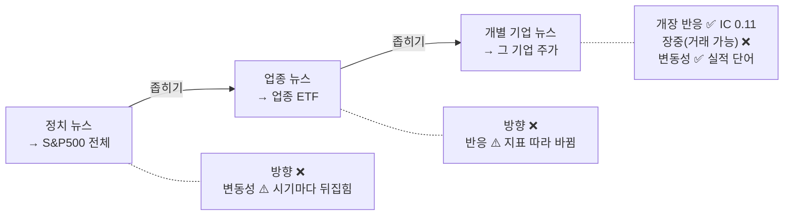

| | 정치 → S&P500 | 업종 → 업종 ETF | 개별 기업 → 주가 |
|---|:---:|:---:|:---:|
| 방향, 거래 가능 구간 | ❌ | ❌ | ❌ IC −0.01 |
| 방향, 반응 설명 (개장 갭) | ❌ | ⚠️ | ✅ **IC +0.11** |
| 크기(변동성) | ⚠️ | ❌ | ✅ **실적 단어 +2.3배** |

---

## 1. 과제 변천

| 단계 | 계획 | 바뀐 이유 |
|---|---|---|
| 1 | 트위치 채팅 크롤링 | 트위치가 2024년 2월 한국 서비스 종료 → 한국어 채팅 부족 |
| 2 | SOOP 실시간 채팅 | 과제 의도가 트위치가 아니라 **X(트위터)** 였음을 확인 |
| 3 | X 정치 글 크롤링 | X 약관이 자동 수집을 금지하고, 대량 수집은 로그인·봇 탐지 우회가 필요. 정치 성향은 개인정보보호법상 **민감정보** → 진행하지 않음 |
| 4 | 공개 데이터셋: HuffPost 뉴스 (2014~2022) | 정치 기사가 2018년 이후 급감 (하루 1~2건) |
| 5 | **NYT Archive API (공식·무료, 2014~2026)** | 12년 내내 하루 7~15건으로 고르고, **발행 시각**까지 있음. HuffPost 우회 크롤링은 robots.txt가 AI 크롤러를 명시적으로 차단해 진행하지 않음 |

---

## 2. 데이터

| 데이터 | 기간 | 규모 | 출처 |
|---|---|---|---|
| HuffPost 정치 기사 제목 | 2014-04 ~ 2022-09 | 34,369건 (정기 연재물 제외) | Hugging Face `heegyu/news-category-dataset` (Kaggle 원본 사본, CC BY 4.0) |
| NYT 전체 기사 메타데이터 | 2014-01 ~ 2026-10 | 744,981건 | NYT Archive API |
| └ 정치 (U.S./Politics, 뉴스만) | | 52,249건 | |
| └ 기술 / 에너지 / 헬스케어 섹션 | | 12,281 / 5,694 / 8,272건 | |
| └ 개별 기업 41곳 (장외 시간 헤드라인) | | 사건 7,069개 | |
| 주가 | 2013-12 ~ 2026-10 | S&P500, 업종 ETF(XLK·XLE·XLV), 개별 종목 41개 | Yahoo Finance |

**정제 규칙:** 소문자화, 불용어 제거, 소유격 제거, "U.S."→usa, NYT 약어("G.O.P."→gop), 정치인 이름 통합("donald trump"→trump), HuffPost 정기 뉴스레터 제외(1,233건).

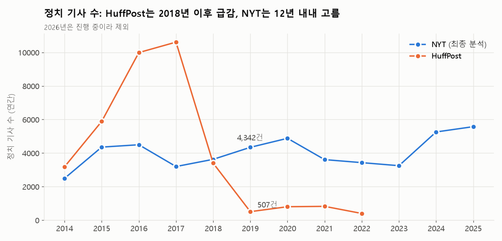

---

## 3. 워드클라우드 결과물

전체 파일은 `deliverables/wordcloud/` (이미지 + 상위 200개 단어 빈도표 csv, 41개)에 있다.

### 3-1. NYT 정치 2014~2026 (연도별)

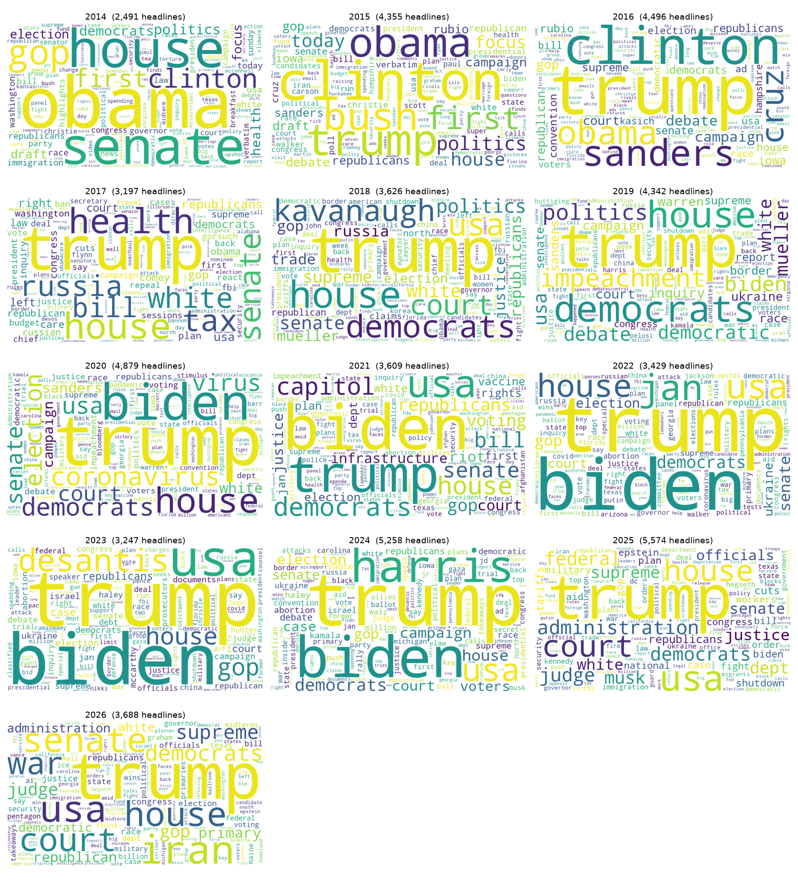

| 연도 | 두드러진 단어 | 사건 |
|---|---|---|
| 2016 | clinton, trump, sanders, cruz | 대선 |
| 2017 | health, tax, russia, repeal | 오바마케어 폐지 시도, 감세, 러시아 수사 |
| 2018 | kavanaugh, mueller, shutdown, trade | 대법관 인준, 특검, 셧다운, 무역 |
| 2019 | impeachment, mueller, ukraine | 1차 탄핵 |
| 2020 | coronavirus, virus, biden | 코로나, 대선 |
| 2021 | capitol, riot, infrastructure, vaccine | 의회 난입, 인프라 법안 |
| 2023 | desantis, documents, charges, classified | 경선, 트럼프 기밀문서 기소 |
| 2024 | harris, biden, vance, walz | 대선 |
| 2025 | tariffs, musk, epstein, shutdown, deportation | 관세, 정부효율부, 셧다운 |
| 2026 | war, iran, midterms | 이란 전쟁, 중간선거 |

### 3-2. NYT 정치 2014~2026 전체 (trump 포함 / 제외)

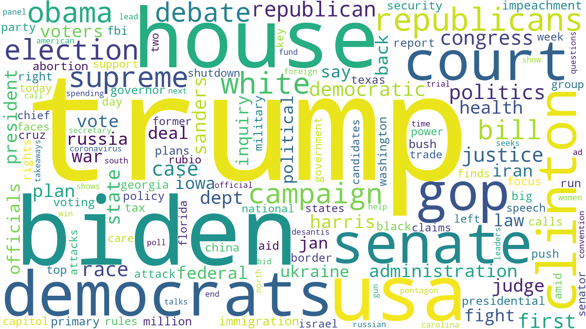
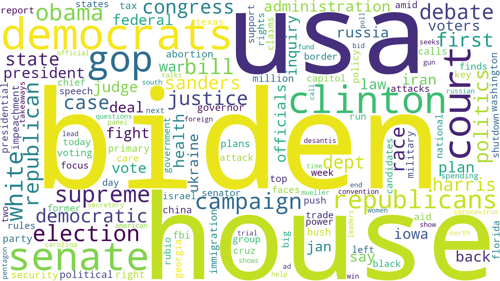

### 3-3. 업종

| 업종 | 상위 단어 |
|---|---|
| 기술 (→XLK) | tech, facebook, google, apple, ai, amazon, twitter, uber, data |
| 에너지 (→XLE) | climate, oil, change, energy, epa, gas, power |
| 헬스케어 (→XLV) | health, study, covid, vaccine, fda, drug, cancer, cdc |

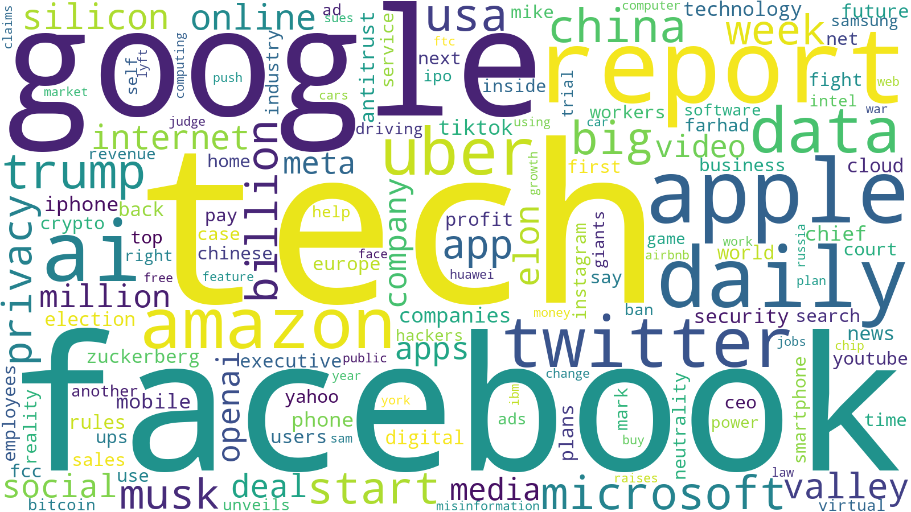

### 3-4. HuffPost 정치 2014~2018

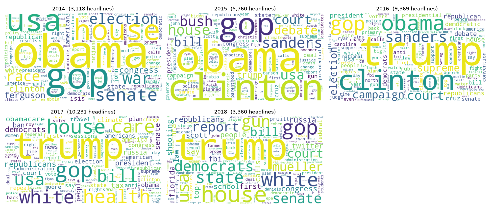

**알려진 한계:** NYT 2014~2016년에는 "first"(First Draft), "focus", "verbatim", "today", "highlights" 같은 **정기 코너 이름**이 섞여 있고, 기술 섹션의 "daily", "report"도 코너 이름(Daily Report)이다. HuffPost에서는 이런 연재물을 제외했지만 NYT에는 아직 적용하지 않았다.

---

## 4. 판별 프로세스

```
① 기사 제목 → ② 정제 → ③ 주간 워드클라우드(단어 빈도) → ④ 단어 사전 점수
→ ⑤ 판정 → ⑥ 색칠 워드클라우드 (초록=호재, 빨강=악재, 회색=중립)
```

| | v1 (`judge.py`) | v2 (`judge_v2.py`, 2026-10-09 고정) |
|---|---|---|
| 사전 | LM(금융), VADER(일반), Claude 초안(정치 리스크 41단어) 중 하나 | 세 사전 모두 |
| 점수 | 단어 100개당 (호재 단어 빈도 − 악재 단어 빈도) | 같음 + **구문 처리** (반전 단어 "avert, end, no…" 앞뒤 2단어면 부호 반전, "debt ceiling·tax cut" 등 두 단어 표현) |
| 판정 | 직전 52주 평균보다 높으면 호재, 낮으면 악재 | 직전 52주 기준 **z > +1 호재, z < −1 악재, 나머지 중립** + **3개 중 2개 이상 합의** |

판정 예시 (NYT 2026-04-12 주): 상위 단어 trump, **iran(27), war(15)**, talks → 세 사전 모두 "가장 강한 악재". 실제 다음 주 S&P500은 **+4.54%**.

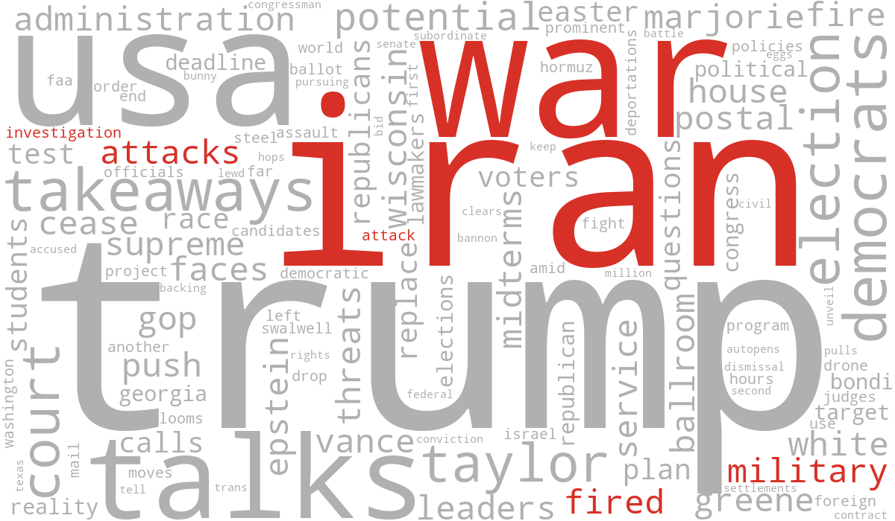

**단어 사전을 만드는 방법 비교:** 사람이 직접 분류(정확하지만 시간 소요로 제외), 기존 감성 사전(LM·VADER), 경제 근거 초안(Claude), 주가로 학습(가짜 데이터 비교에서 우연과 구별되지 않아 제외).

---

## 5. 리서치: 뉴스가 투자에서 차지하는 비중

| 연구 | 핵심 |
|---|---|
| Cutler·Poterba·Summers (1989) "What Moves Stock Prices?" | 거시 뉴스로는 주가 변동의 1/3 이상을 설명하기 어렵다. 큰 정치·국제 사건에 대한 반응은 작았고, 큰 움직임이 뉴스 없는 날 자주 발생 |
| Roll (1988) | 시장·업종·공개 뉴스를 다 넣어도 개별 주식 일간 수익률 설명력(R²) 약 20% |
| Boudoukh 외 (2019, RFS) | **기업별** 실질 뉴스는 장 외 시간 개별 종목 변동성의 49.6%를 설명 (장중 12.4%) |
| Ke·Kelly·Xiu (NBER) | 뉴스와이어 텍스트로 수익률 예측 가능, 단 며칠 안에 가격에 반영 |
| Tetlock (2007, JF) | 언론의 비관적 단어 → 다음 날 하락 후 며칠 안에 되돌림 (투자 심리·노이즈 해석) |
| 실무 (AIMA, Lowenstein Sandler 설문) | 대체 데이터 사용 증가. 뉴스·SNS 감성은 **여러 신호 중 하나**로 사용. 뉴스 단독 사용 비율을 집계한 신뢰할 만한 설문은 찾지 못함 |

---

## 6. 검증 결과

모든 실험의 공통 원칙: 결과를 보기 전에 규칙 고정 · 기간을 나눠 재현 확인 · 미래 정보 사용 금지(기사 이후 거래 가능한 가격과 비교) · 시험 횟수만큼 우연이 섞임을 고려(가짜 데이터 비교).

### 6-1. 정치 뉴스 → S&P500

| 실험 | 결과 | 판정 |
|---|---|---|
| 단어 빈도 → 다음 날 수익률 (HuffPost, 856단어) | 앞 기간 유의 49개 vs 가짜 데이터 평균 41개, 뒤 기간 재현율 61% (가짜 50%, 가짜가 이만큼 나올 확률 10%). 뽑힌 단어도 war=호재, president=악재 등 비경제적 | 기각 |
| 감성 톤(LM·VADER) → 다음 날 | LM 앞 기간 +24bp(p=0.001) → **뒤 기간 −7bp로 뒤집힘** | 기각 |
| 주간 판정 v1 → 다음 주 (HuffPost) | 세 사전·두 기간 모두 + 방향(+0.14~0.49%p)이나 유의하지 않음 (최소 p=0.08) | 보류 |
| **같은 v1을 NYT 12년에 그대로 적용** | 9개 결과 모두 유의하지 않고 방향도 섞임. 처음 보는 2022.10~2026.09에서 Claude 사전 차이 +0.01%p | **기각 (재현 실패)** |
| 주간 판정 → 다음 주 변동성 (이번 주 변동성 통제) | A·C 구간 +, B 구간 −로 뒤집힘. Claude C 구간 +0.31%p(p=0.006) | 보류 |
| v2 (3단계·합의·구문) → 방향·변동성 | 77% 주가 중립. 방향 무의미, 변동성은 C 구간에서 v1과 **반대 부호**(−0.43, p=0.04) | 기각 |

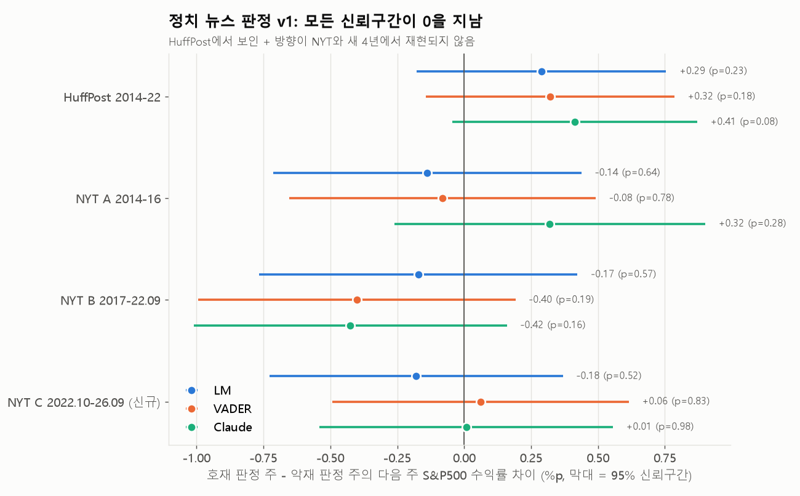

> 점이 0의 오른쪽이면 "호재 판정 주 다음에 더 올랐다"는 뜻. 12개 막대가 모두 0을 지나므로 어느 것도 우연과 구별되지 않는다. HuffPost(위)의 + 방향이 NYT(아래)에서는 섞이거나 뒤집혔다.

### 6-2. 업종 뉴스 → 업종 ETF 초과 수익률 (ETF − S&P500)

| 실험 | 결과 | 판정 |
|---|---|---|
| 주 단위 (LM, 업종 사전) | 전체 기간 6개 모두 0 근처 (p 0.17~0.96). 에너지+LM은 B +0.70%p → C −1.15%p로 뒤집힘 | 기각 |
| 하루 단위, 개장 전 뉴스 → 개장 갭 | 업종 사전: 기술 +6.9bp(p=0.11), 헬스케어 +9.0bp(p=0.04). **IC로는** 0.03, 0.06 (유의하지 않음) | 보류 (지표 따라 결론 약해짐) |
| 하루 단위 → 장중 (거래 가능) | 업종 사전에서 오히려 −8~−12bp (되돌림 방향, p≈0.1), IC 유의하지 않음 | 기각 |

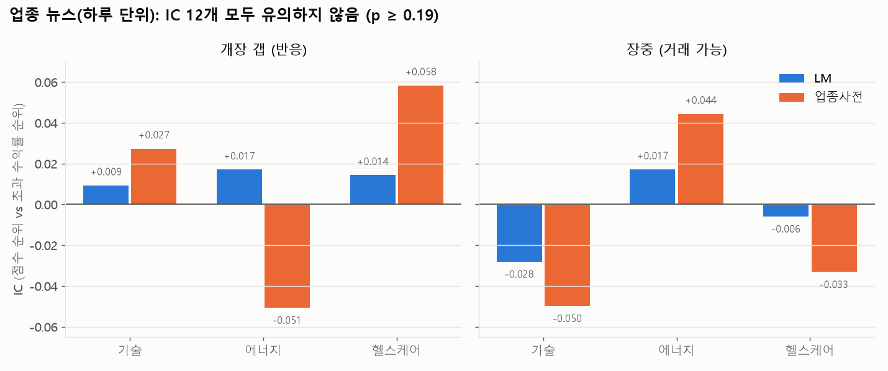

> 업종 사전(주황)은 개장 갭에서 +, 장중에서 −로 "반응 후 되돌림" 모양이지만 크기가 작고 유의하지 않다. 평균 차이로는 유의했던 헬스케어(p=0.04)가 IC로는 p=0.23 — 지표를 바꾸면 결론이 약해지는 결과는 믿기 어렵다.

### 6-3. 개별 기업 뉴스 → 그 기업 주가 (41개 기업, 사건 7,069개)

반응 = 회사 초과 수익률 ÷ 직전 60일 평소 변동폭. 사건 날짜 중앙값(2019-04-05)으로 앞/뒤 절반 분할.

**방향 (LM 사전 점수 vs 반응, IC)**

| | 앞 절반 | 뒤 절반 | 전체 |
|---|---|---|---|
| 개장 갭 (전일 종가→시가) | +0.095 | +0.120 | **+0.109** (p<0.001) |
| 장중 (시가→종가, 거래 가능) | −0.010 | −0.015 | **−0.013** (p=0.49) |
| 개장 갭, 주가 묘사 헤드라인 제외 | +0.073 | +0.100 | **+0.087** (p<0.001) |

→ 기사 톤은 주가 방향과 연결되지만 **전부 개장 갭에서 반영**되고 장중에는 남지 않음. 주가 묘사 헤드라인("Shares Fall" 등, 7%)을 빼도 유지 → 단순 보도가 아니라 내용에 대한 반응.

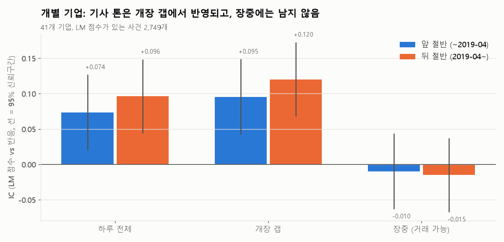

**크기 (어떤 단어가 나오면 크게 움직이나)**

| | 앞뒤 모두 유의 + 같은 방향인 단어 |
|---|---|
| 실제 | **20개** |
| 가짜 데이터 평균 | 2.5개 (200번 중 실제만큼 나온 적 0번) |

- 크게 움직이는 단어: **revenue, quarter, profit(s), growth, strong, earnings, reports, posts, sales, billion, loss** (평소의 +1~+4배)
- 덜 움직이는 단어: tv, app, pay, employees, fight, world, twitter, use
- 실적 단어가 있는 날: 개장 갭 **+2.25배**, 장중 **+0.58배** (두 기간 모두 p<0.001)

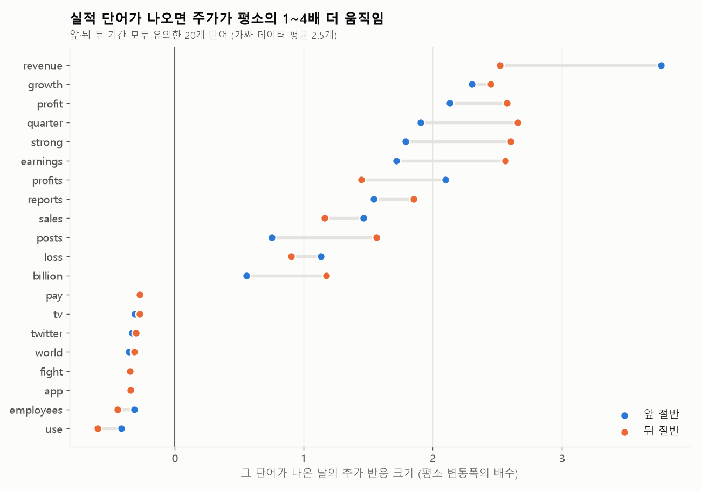

> 파랑(앞 절반)과 주황(뒤 절반)이 같은 쪽에 모여 있으면 두 기간에서 재현된 것. 실적 단어는 오른쪽(크게 움직임), 제품·사회 이슈 단어는 왼쪽(덜 움직임)에 모인다.

---

## 7. 결론

1. **워드클라우드는 이슈 요약 도구로 유효하다.** 연도별·업종별 핵심 사건이 그대로 드러난다.
2. **호재/악재 판별 → 주가 방향 예측은 기각.** 정치(시장 전체)·업종 단위에서는 신호가 우연과 구별되지 않았고, 한 데이터에서 보인 약한 신호도 다른 매체와 새 기간에서 재현되지 않았다.
3. **개별 기업 단위에서는 뉴스 단어가 주가 반응을 설명한다(유망).** 다만 효과는 개장 시점에 이미 가격에 반영되어 거래 전략으로는 쓸 수 없다.
4. **실적 관련 단어는 그날의 변동성을 알려준다.** 장중에도 평소보다 약 50% 더 움직인다. 단, 실적 발표일의 높은 변동성은 널리 알려진 현상이다.
5. 결과는 금융 연구의 결론과 일치한다: 뉴스는 중요하지만(특히 기업 뉴스), 빠르게 반영되며, 거시·정치 뉴스의 설명력은 작다.

## 8. 한계

- 개별 기업 반응은 **"뉴스가 주가를 움직였다"가 아니라 "같은 사건(실적 발표 등)에 기사와 주가가 함께 반응했다"**로 해석해야 함. 실적은 장 마감 후 발표되어 시간외 거래에서 먼저 반영됨
- 사전 기반 방법만 사용. 연구에서 효과를 낸 방법은 수익률로 **학습한** 텍스트 모델과 실시간 뉴스와이어
- NYT는 일반 독자용 매체. 금융 속보 매체(다우존스 등)와 다름
- 기업 이름 매칭은 헤드라인의 이름만 사용 (애매한 이름 Visa·Target 등 제외)
- 거래 비용 미반영
- Claude 사전은 이 기간의 사건(셧다운·관세)을 알고 작성되어 약간의 사후 지식 가능성
- NYT 정기 코너 이름 미제거
- 하루 단위 업종 분석에서 "사전 단어 0개인 날 제외"는 첫 결과 확인 후 적용한 수정 (판정 분포 쏠림으로 발견)
- v1 HuffPost에서 NYT로의 이동, 주 단위·52주 기준 등은 앞선 실패 이후 정한 설계라 시도 횟수에 따른 우연 가능성이 남음

## 9. 다음에 해볼 수 있는 것

- v2 전진 검증: `python validate_v2.py --update` (고정 지문 `825673dfee0e`). 단, 악재 판정이 연 6주 정도라 결론까지 수년 필요
- 수익률로 학습하는 텍스트 모델 (연구 방식) — 반드시 시간 순서로 나눈 검증 필요
- 실적 발표일 변동성과 옵션 내재 변동성 비교 (이미 가격에 반영됐는지)

---

## 부록 A. 파일 목록

| 파일 | 내용 |
|---|---|
| `deliverables/wordcloud/` · `deliverables/wordcloud_2026-10-10.zip` | **전달용 워드클라우드 41개 (이미지 + 빈도표)** |
| `wordcloud_politics.py` | 정제 규칙, HuffPost 워드클라우드 |
| `word_returns.py`, `sentiment_returns.py` | HuffPost 단어·감성 → 다음 날 수익률 |
| `judge.py`, `dict_claude.csv` | 판별 프로세스 v1, Claude 정치 리스크 사전 |
| `nyt_download.py`, `nyt_download_upto.py` | NYT Archive API 다운로드 (키: `D:\Downloads\files\nyt_api_key.env`) |
| `judge_nyt.py`, `volatility_nyt.py` | v1의 NYT 재현, 변동성 |
| `judge_v2.py`, `validate_v2.py` | 판별 프로세스 v2, 참고·전진 검증 |
| `sector_nyt.py`, `sector_daily.py`, `dict_sector.csv` | 업종 주 단위·하루 단위, 업종 사전 |
| `firms.csv`, `firm_words.py`, `firm_followup.py` | 기업 이름 매칭, 기업 단어 반응, 거래 가능·보도 효과 점검 |
| `make_deliverables.py` | 전달용 워드클라우드 생성 |
| `make_charts.py`, `deliverables/charts/` | 보고서 그래프 5종 (저장된 결과 파일만 읽음) |
| `output/` | 모든 실험 결과(csv)와 로그 |

## 부록 B. 참고 문헌

- Cutler, Poterba, Summers (1989), *What Moves Stock Prices?* — https://cutler.scholars.harvard.edu/publications/what-moves-stock-prices
- Roll (1988), R² — https://archive.nyu.edu/bitstream/2451/27594/2/SSRN-id272287.pdf
- Boudoukh, Feldman, Kogan, Richardson (2019), *Information, Trading, and Volatility* — https://cris.huji.ac.il/en/publications/information-trading-and-volatility-evidence-from-firm-specific-ne/
- Boudoukh 외, *Which News Moves Stock Prices?* — https://www.nber.org/papers/w18725
- Ke, Kelly, Xiu, *Predicting Returns with Text Data* — https://www.nber.org/papers/w26186
- Tetlock (2007), *Giving Content to Investor Sentiment* — https://www.columbia.edu/~pt2238/papers/Tetlock_Media_Sentiment_JF.pdf
- AIMA, *Casting the Net* — https://www.aima.org/static/8778b1e4-75c3-44e4-b35dc38e1495001e/Casting-The-Net-v10.pdf
- Lowenstein Sandler (2025), 대체 데이터 설문 — https://www.lowenstein.com/media/jujd45bp/alt-data-report-2025_final.pdf
- News Category Dataset — https://paperswithcode.com/paper/news-category-dataset
- SOOP Chat SDK 문서 — https://developers.sooplive.co.kr/docs/chatsdk/overview
